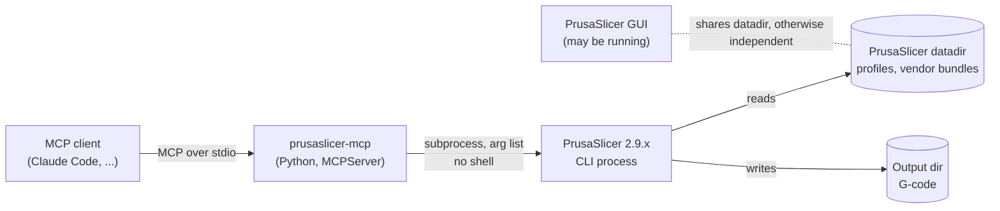

# Architecture

How `prusaslicer-mcp` works **today**. Why it works this way is in [`../decisions/`](../decisions/README.md).
If this document disagrees with the code, fix the document in the same change.

## Purpose and scope

An MCP server (stdio transport) that lets an MCP client such as Claude discover installed
PrusaSlicer printers and profiles, sanity-check a model, and slice it headlessly with the user's real
profiles. It wraps the **PrusaSlicer 2.9.x command line** ([ADR 0002](../decisions/0002-wrap-the-prusaslicer-2-9-cli.md)).

Out of scope: controlling or reading the running GUI, PrusaSlicer 3.x features (Lua plugins), and
printer control (use Prusa Connect / PrusaLink tooling for that).

## System context



Each tool call that touches PrusaSlicer starts a short-lived, separate CLI process. The GUI, if
open, is neither used nor disturbed.

## Code layout

```
src/prusaslicer_mcp/
  __init__.py   exports main()
  server.py     MCPServer instance, tool definitions, input validation, result models
  cli.py        run(): async subprocess wrapper around the PrusaSlicer binary
  config.py     executable + datadir discovery, env-var configuration
  gcode.py      parse print statistics from text G-code
  project.py    read the profiles and key settings stored in a PrusaSlicer project 3MF
  slicer_output.py  turn PrusaSlicer's stdout into warnings
  preview_model.py  render a mesh to a picture (numpy + Pillow)
  preview_gcode.py  read toolpaths from G-code and draw a layer or a side silhouette
  repair.py     find the open boundaries of a mesh and cap the flat ones (numpy)
scripts/dogfood/     opt-in sweep that runs every tool over a folder of real models (docs/dogfooding.md)
tests/               unit tests (no PrusaSlicer) plus a few integration tests; see Testing below
.github/
  workflows/ci.yml             lint, types, audit, unit (3.12, 3.14), integration (macOS), commitlint
  workflows/release-please.yml release pull request from Conventional Commits
  scripts/setup-prusaslicer-macos.sh   installs PrusaSlicer and a throwaway data directory for CI
```

| Module | Responsibility | Depends on |
|---|---|---|
| `config.py` | Resolve `Config(executable, datadir, output_dir, timeout)` from env and platform defaults. Raises `ConfigError` (`PrusaSlicerNotFound` is a subclass) for an unusable setting. | stdlib |
| `cli.py` | `run(config, args, timeout)` → `CliResult(returncode, stdout, stderr)`. Prepends `--datadir` when configured. Kills the process on timeout (`CliTimeout`). | `config` |
| `gcode.py` | `parse_gcode_stats(path)` → `GcodeStats`. Rejects binary G-code. `layer_gap_warning(path)` reads the `;Z:` layer markers and describes stretches where the print jumps up by more than three typical layers (and at least 0.6 mm), meaning nothing is printed there. | pydantic |
| `slicer_output.py` | `parse_warnings(stdout)` → one string per PrusaSlicer warning. A warning is a block: a line containing "warning" plus the plain lines after it (more gaps, object name, advice), up to the next `NN => ...` progress line or the final export message. | stdlib |
| `preview_model.py` | `render_model(mesh, view, size)` → a Pillow image: samples the surface, projects it orthographically, z-buffers, shades two-sided and fills sampling gaps. Views `iso`, `front`, `side`, `top` and `sheet`; z is up; the model is centred whatever its position. ([ADR 0011](../decisions/0011-render-previews-with-numpy-and-pillow.md)) | numpy, Pillow |
| `preview_gcode.py` | `scan_gcode(path)` and `iter_extrusions(path)` read the extruding `G1` moves (relative or absolute extrusion, start purge line excluded, `G2`/`G3` counted but not drawn) with their layer, height and `;TYPE:` feature; `render_layer` draws one layer with the layer below as a ghost; `render_profile` draws front and side silhouettes on a 10 mm grid. | numpy, Pillow |
| `repair.py` | `find_holes(mesh)` → `Hole`s (edges, ordered loop or `None` if the boundary branches, flatness, size, `closable`); `close_holes(mesh)` → `Closing(mesh, closed, left_open)`. A hole is closable when it is one simple loop of 12 to 10,000 edges within 0.1 of flat; it is capped by ear clipping in its best-fit plane, wound against the faces' edge direction. Never edits its input. ([ADR 0014](../decisions/0014-cap-flat-holes-on-request.md)) | numpy (`trimesh` only to build the result) |
| `project.py` | `read_project(path)` → `ProjectInfo` (stored printer/print/material profile names and `KEY_SETTINGS`) or `None` when the file is not a `.3mf` that embeds `Metadata/Slic3r_PE.config`. | stdlib, pydantic |
| `server.py` | Tool surface. Validates input, builds CLI args, shapes pydantic results. Lazily loads `Config` on first use (`get_config()`). | all of the above, `trimesh` |

## Tools

| Tool | PrusaSlicer involvement | Notes |
|---|---|---|
| `list_printers(technology)` | `--query-printer-models --printer-technology {FFF,SLA}` | Flattens model → nozzle variant → printer profile. Read-only. |
| `list_profiles(printer_profile)` | `--query-print-filament-profiles --printer-profile ...` | Print profiles with compatible filament profiles. Read-only. |
| `inspect_model(model_path, bed_*, max_height)` | none, except `--export-stl` for a STEP file | `trimesh` load (off the event loop; a STEP file is first converted by PrusaSlicer, `_export_mesh`, [ADR 0016](../decisions/0016-read-step-files-through-prusaslicer.md)); size, volume (only when watertight), part count, `open_holes` and `closable_holes` (see `repair.py`; a warning names `close_holes` when some can be capped), optional fit check, and `project` (see `project.py`) for a 3MF saved from PrusaSlicer. `fits_bed` compares size only (rotation not considered). For a `.3mf` with a bed given it also warns when the stored position is off the bed, since PrusaSlicer keeps a 3MF's coordinates (see Known quirks). Read-only. |
| `slice_model(model_path, printer_profile?, print_profile?, material_profile?, overrides, output_path, center?, rotate_x, rotate_y, rotate_z, scale, scale_to_fit, split, copies, close_holes)` | `--export-gcode --binary-gcode=0 [--printer-profile ... --print-profile ... --material-profile ...] [--center X,Y] ...` | Writes G-code; returns path + `GcodeStats` + `settings_from` (`profiles`/`project`) + warnings. The three profiles are all-or-none; none is allowed only for a PrusaSlicer project, which is then sliced with its own saved settings ([ADR 0007](../decisions/0007-slice-prusaslicer-projects-with-their-own-settings.md)). Transforms map to `--rotate-x`, `--rotate-y`, `--rotate`, `--scale`, `--scale-to-fit`, `--split` and `--duplicate` ([ADR 0012](../decisions/0012-transform-with-prusaslicers-own-flags.md)), validated before anything is written. `center` is three-valued: omitted centres a plain 3MF only, `true` or `false` is honoured ([ADR 0013](../decisions/0013-centre-plain-3mf-files-automatically.md)), and the result reports `centered`; `close_holes` caps the model's flat holes in memory (off the event loop), refuses a project, and slices a repaired STL written to the same scratch folder, named after the model, while the file itself is untouched; the result reports `holes_closed` and always carries one warning saying what it did ([ADR 0014](../decisions/0014-cap-flat-holes-on-request.md)); centring looks up the bed size (`_bed_center`, via `--query-printer-models`, for the given printer profile or the project's own) and centres on its middle, assuming a corner origin. Not read-only. |
| `preview_model(model_path, view, size, rotate_x, rotate_y, rotate_z, scale, scale_to_fit, close_holes)` | `--export-stl [transform flags]` when a transform is given or the file is STEP | Loads the mesh like `inspect_model`, renders it, and returns a PNG plus a caption with the size and a note that z is up. The transforms are validated by `_transform_args`, the same code as `slice_model`, and applied by PrusaSlicer's own `--export-stl` into a temporary folder, so the picture is what it will print, quirks included ([ADR 0015](../decisions/0015-preview-transforms-by-asking-prusaslicer.md)); `close_holes` caps the mesh in memory first and PrusaSlicer is handed the capped copy. The caption names what was applied. `size` is 128 to 1024 (default 640). Read-only. |
| `preview_gcode(gcode_path, view, layer, size)` | none | `view=layer` (default; `layer` counts from 1, default the middle layer) or `view=profile`. Refuses binary G-code and files with no extruding moves. The profile caption repeats the layer-gap warning. Read-only. |

Profile names are exact-match; callers get them from `list_printers` / `list_profiles`.

## Previews

`preview_model` and `preview_gcode` return a PNG and a text caption through the SDK's `Image` helper ([ADR 0011](../decisions/0011-render-previews-with-numpy-and-pillow.md)). Both are read-only. `preview_gcode` needs no PrusaSlicer, and neither does `preview_model` unless it is given a transform or a STEP file. Known limits:

- Orthographic only: no perspective, no textures, simple two-sided shading. The model is drawn as stored (or as PrusaSlicer transforms it, when asked), z up, so a Y-up scan appears lying down, which is the point.
- `preview_gcode` reads text G-code only (ADR 0005), parses in plain Python in two passes (about 2 s per million extruding moves), and does not draw arcs (`G2`/`G3`); it counts them and says so in the caption.
- The side silhouette fits both panels to the larger of the x and y extent, so a wide, low print uses only part of the picture.
- Pictures are 128 to 1024 px square (default 640), to bound the cost of reading them.

## Data flow: `slice_model`

```mermaid
sequenceDiagram
    participant C as MCP client
    participant S as server.slice_model
    participant R as cli.run
    participant P as PrusaSlicer
    participant G as gcode.parse_gcode_stats
    C->>S: model, [printer/print/material profile], overrides
    S->>S: validate model path + suffix; profiles all-or-none (none only for a project); validate override keys/values
    S->>R: args (--export-gcode --binary-gcode=0 [--printer-profile ...] --output ...)
    R->>P: exec (arg list, --datadir, timeout)
    P-->>R: exit code, stdout, stderr; G-code file
    R-->>S: CliResult
    S->>S: fail if exit != 0 or output missing
    S->>G: parse output file
    G-->>S: GcodeStats (time, filament, cost, layers)
    S->>G: layer_gap_warning (empty stretches in the model's height)
    S-->>C: SliceResult(gcode_path, stats, settings_from, warnings)
```

## Configuration

Read in `config.py`; documented in `.env.example` and the README ([ADR 0006](../decisions/0006-configuration-via-environment-and-direnv.md)).

| Variable | Used for | Default |
|---|---|---|
| `PRUSASLICER_PATH` | Executable. If set but invalid, the server errors rather than falling back. | auto-detect |
| `PRUSASLICER_DATADIR` | Passed as `--datadir` | platform default if the directory exists |
| `PRUSASLICER_MCP_OUTPUT_DIR` | Default G-code location, created in full if missing (it is the user's own setting) | `./output` (relative to the server's cwd, resolved at startup) |
| `PRUSASLICER_MCP_TIMEOUT` | Per-call timeout (s) for slicing, a positive number; queries use 60 s | `600` |

Executable resolution order: `PRUSASLICER_PATH` → `PATH` (`prusa-slicer`, `PrusaSlicer`, `prusa-slicer-console`) → platform install globs (macOS `/Applications/**/PrusaSlicer.app`, Windows `Program Files`).

### Client registration

`.mcp.json` at the repo root registers the server for Claude Code at project scope (`uv run prusaslicer-mcp`, no `env`, no paths). The client starts it with the project root as cwd, so the default `./output` lands in the git-ignored `output/` directory. The server inherits `PRUSASLICER_*` variables only from the environment `claude` was launched in; `.env` is not read by the server itself.

## Error handling and safety

- A refused slice keeps PrusaSlicer's own message and gets advice where the remedy is known (`_explain_failure`): profile names, a model bigger than the bed (sizes compared, with `scale_to_fit` and, if it fits across the diagonal, `rotate_z=45`), an empty first layer (which names `close_holes`), and the wipe-tower conflict. The advice is best effort and never hides the original message.
- Every expected failure (bad input, PrusaSlicer not found, timeout, slicer or query error) is raised as `ToolError`. In MCP SDK 2.x only `ToolError` text reaches the client; any other exception is a "crash" whose message is withheld (`Error executing tool <name>` only). `server._run` converts `CliTimeout`, `get_config` converts `ConfigError` (PrusaSlicer not found, or an invalid setting such as a non-positive `PRUSASLICER_MCP_TIMEOUT`). A slicer "outside of the print volume" failure adds a hint to retry with `center=true`, and a "profile ... wasn't found" failure (from slicing or a query) adds a hint to take exact names from `list_printers` / `list_profiles`.
- No shell is ever involved. Subprocesses use `create_subprocess_exec` with an argument list and `stdin` closed.
- Setting overrides: keys must match `^[a-z][a-z0-9_]*$`, values may not contain newlines, and each is emitted as one `--key=value` argument (underscores become hyphens). Keys the server controls itself (`_RESERVED_OVERRIDES`: `export_gcode`, `binary_gcode`, the three profile flags, `output`, `datadir`, `center`) and `save`, which would write into the user's PrusaSlicer data directory, are rejected, because an override is appended after the server's own flags and would otherwise win (`binary_gcode=1` produced binary G-code, breaking [ADR 0005](../decisions/0005-always-slice-to-text-gcode.md)). Everything is validated before any folder is created, so a refused request leaves nothing on disk. A caller-supplied `output_path` may create only its own last folder: if neither that folder nor its parent exists the call is refused (a mistyped path would otherwise silently build a tree), and a folder that cannot be created is a readable `ToolError`.
- Model paths are resolved, must exist, and must have a supported extension (`.stl .3mf .obj .amf .step .stp`).
- Nothing writes into the PrusaSlicer data directory.
- stdout is reserved for the MCP protocol; diagnostics go to stderr.

## Known quirks (PrusaSlicer 2.9.7)

- **Rotations are fixed-axis X, then Y, then Z, except at +-90 about Y.** Fitting the matrix of `--export-stl` showed generic angles follow that order exactly, but `--rotate-y 90 --rotate -90` turns the model a different way up (slicing agrees). `preview_model` therefore asks PrusaSlicer for the transformed mesh instead of computing it ([ADR 0015](../decisions/0015-preview-transforms-by-asking-prusaslicer.md)).
- **`--export-stl` converts STEP** (0.2 s for a 442 kB assembly) and applies transform flags, which is how `inspect_model`, `preview_model` and the transformed preview read STEP and transforms ([ADR 0016](../decisions/0016-read-step-files-through-prusaslicer.md)). It exits 0 on success and writes the file.
- **`--merge` segfaults** (exit 139), even with `--info` and with a single file, so plates of several files are not offered. `--dont-arrange` keeps raw coordinates and so drops origin-centred models off the bed. `--duplicate` and `--split`, which also arrange, work.
- **Transform flags apply in a fixed order** (rotate X, then Y, then Z) whatever order they are passed. `--scale 50` means fifty times, not 50%; only factors are offered. `--center` is applied after the transforms.
- **PrusaSlicer exits 0 for some refusals** ("All objects are outside of the print volume", the wipe-tower-with-sequential-printing conflict), so the exit code cannot decide success. A file already at the output path made such a refusal look like a success with the earlier slice's statistics. `slice_model` therefore slices into a private scratch folder next to the destination and moves the result into place only if PrusaSlicer actually wrote it, which also leaves the previous file intact when a slice fails.
- **A successful slice can still be unprintable.** A scan exported Y-up slices without error and with plausible statistics, but it lies on its side, so whole stretches of its height print nothing (an 88 mm statue had four gaps totalling 33 mm). The scan we found this with also has a real hole: its base has no bottom face (687 open edges), so rotated head-up PrusaSlicer refuses it (`object with no extrusions in the first layer`), and rotated head-down it slices cleanly but upside down. `slice_model(close_holes=true)` caps that hole and the scan then slices head-up at its full height. PrusaSlicer's own warning is multi-line, is truncated (`(Some lines not shown)`) and did not list every gap, so `slice_model` returns that whole block and also checks the G-code's layer heights itself (`layer_gap_warning`). `preview_model` and `preview_gcode` exist to make this visible.
- **Profile flags override a project's embedded settings.** Passing `--printer-profile`/`--print-profile`/`--material-profile` with a project 3MF makes PrusaSlicer use the plain profile values and ignore what the project saved (supports, brim, infill...). Without the flags it uses the project's own configuration. `slice_model` therefore omits them for a project when none are given ([ADR 0007](../decisions/0007-slice-prusaslicer-projects-with-their-own-settings.md)).
- `--query-*` actions **exit with status 1 even when they succeed**. `_query_json` therefore checks that the `-o` file exists, is non-empty, and parses, instead of the exit code.
- Printer *model* names in the vendor bundles are wx-escaped (`&&` renders as `&` in the GUI), while profile names use a single `&` (e.g. `Original Prusa MINI & MINI+ Input Shaper`). `list_printers` unescapes the model `name` for display (`_display_name` in `server.py`); `id` and every `printer_profile` value are passed through untouched. Always pass the `printer_profile` value, not the model name.
- Recent profiles default to **binary G-code**; we force text output ([ADR 0005](../decisions/0005-always-slice-to-text-gcode.md)).
- A plain 3MF (CAD export, not a PrusaSlicer project) keeps its stored coordinates, so a part modelled around the origin is half off the bed and slicing fails with "All objects are outside of the print volume"; `--merge` does not help for a single file. `slice_model(center=true)` passes `--center` with the bed middle. In our runs an STL was placed automatically without any flag (observed, not checked in the PrusaSlicer source). No other transform flags are exposed yet. `slice_model` centres plain 3MF files by default; automatic centring is best effort (skipped if the printer's bed cannot be found) while an explicit `center=true` fails clearly.

## Testing

`uv run poe check` runs lint, format check, type check and the unit tests; `uv run poe test-integration` runs the
rest. Tasks are defined once in `[tool.poe.tasks]` and CI calls the same ones ([ADR 0009](../decisions/0009-quality-gate-toolchain.md)).
Beyond the tests, `uv run poe dogfood run <folder>` sweeps a folder of real models through every tool and reports
crashes, timeouts, refusals, warnings and suspicious results ([docs/dogfooding.md](../dogfooding.md)); it is opt-in.

| Kind | What it needs | Where |
|---|---|---|
| Unit | nothing; PrusaSlicer's command line is faked (`cli.run`), or a throwaway shell script stands in for it | most of `tests/` |
| Protocol | nothing; starts the real server as a subprocess and talks to it over stdio | `tests/test_stdio.py` |
| Integration | a real PrusaSlicer; marked `integration` automatically when a test uses the `prusaslicer` fixture, and skipped when no install is found | `tests/test_server.py` |

CI (`.github/workflows/ci.yml`) runs these jobs: lint and format, type check (`ty` via `uv check`, pinned, then pyright; [ADR 0010](../decisions/0010-pin-ty-and-add-pyright.md)), dependency audit, unit tests on
Python 3.12 and 3.14 with a 95% coverage floor, integration tests on macOS, and commitlint, then a final `ci` job that depends on all of them and fails unless each one succeeded. Branch protection requires that one `ci` check (GitHub names checks after jobs, not workflows), so adding or renaming a job never breaks the ruleset; a new job must be added to the `ci` job's `needs`. The integration job
installs the official 2.9.7 `.dmg` (cached by version, `PRUSASLICER_VERSION` in the workflow) and builds a
throwaway data directory from the profiles inside the app. Linux is not covered because Prusa no longer attaches Linux
builds to its GitHub releases.

## Releases

Release Please (`.github/workflows/release-please.yml`, [ADR 0008](../decisions/0008-conventional-commits-and-release-please.md)) reads the Conventional Commits on `main` and keeps a release pull request open. Merging it tags `prusaslicer-mcp-vX.Y.Z`, publishes a GitHub release, writes `CHANGELOG.md`, and bumps the version in `pyproject.toml`, `uv.lock` and `.release-please-manifest.json`. Nothing is published to PyPI.

Only `feat`, `fix`, `perf` and `revert` commits appear in the notes and can trigger a release; every other type is hidden, and Release Please skips a release whose notes would be empty. Before 1.0 a `feat` bumps the minor version and a `fix` the patch.

## Extension points and next steps

Planned work is tracked in [`ROADMAP.md`](../../ROADMAP.md). Natural seams in the current design:

- New tools: add to `server.py` (or a new module if it grows), keeping validation and result models together.
- New CLI behaviour: extend arguments built in `server.py`; keep subprocess handling in `cli.py`.
- New statistics: extend `gcode.py` and its unit tests.
- Reading or writing other formats (3MF projects, bgcode) belongs in new modules, not `server.py`.
