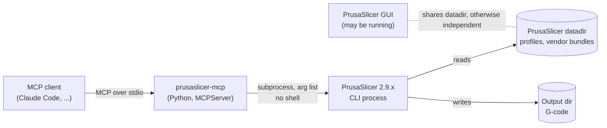

# Architecture

How `prusaslicer-mcp` works **today**. Why it works this way is in [`../decisions/`](../decisions/README.md).
If this document disagrees with the code, fix the document in the same change.

## Purpose and scope

An MCP server (stdio transport) that lets an MCP client such as Claude discover installed
PrusaSlicer printers and profiles, sanity-check a model, and slice it headlessly with the user's real
profiles. It wraps the **PrusaSlicer 2.9.x command line** ([ADR 0002](../decisions/0002-wrap-the-prusaslicer-2-9-cli.md)).

Out of scope: controlling or reading the running GUI, PrusaSlicer 3.x features (Lua plugins), and
printer control (use Prusa Connect / PrusaLink tooling for that).

## System context



Each tool call that touches PrusaSlicer starts a short-lived, separate CLI process. The GUI, if
open, is neither used nor disturbed.

## Code layout

```
src/prusaslicer_mcp/
  __init__.py   exports main()
  server.py     MCPServer instance, tool definitions, input validation, result models
  cli.py        run(): async subprocess wrapper around the PrusaSlicer binary
  config.py     executable + datadir discovery, env-var configuration
  gcode.py      parse print statistics from text G-code
tests/
  conftest.py       prusaslicer fixture (skips if not installed), cube_stl fixture
  test_gcode.py     parser unit tests (no PrusaSlicer needed)
  test_server.py    integration tests against a real install
```

| Module | Responsibility | Depends on |
|---|---|---|
| `config.py` | Resolve `Config(executable, datadir, output_dir, timeout)` from env and platform defaults. Raises `PrusaSlicerNotFound`. | stdlib |
| `cli.py` | `run(config, args, timeout)` → `CliResult(returncode, stdout, stderr)`. Prepends `--datadir` when configured. Kills the process on timeout (`CliTimeout`). | `config` |
| `gcode.py` | `parse_gcode_stats(path)` → `GcodeStats`. Rejects binary G-code. | pydantic |
| `server.py` | Tool surface. Validates input, builds CLI args, shapes pydantic results. Lazily loads `Config` on first use (`get_config()`). | all of the above, `trimesh` |

## Tools

| Tool | PrusaSlicer involvement | Notes |
|---|---|---|
| `list_printers(technology)` | `--query-printer-models --printer-technology {FFF,SLA}` | Flattens model → nozzle variant → printer profile. Read-only. |
| `list_profiles(printer_profile)` | `--query-print-filament-profiles --printer-profile ...` | Print profiles with compatible filament profiles. Read-only. |
| `inspect_model(model_path, bed_*, max_height)` | none | `trimesh` load; size, volume (only when watertight), part count, optional fit check. `fits_bed` compares size only (rotation not considered). For a `.3mf` with a bed given it also warns when the stored position is off the bed, since PrusaSlicer keeps a 3MF's coordinates (see Known quirks). Read-only. |
| `slice_model(model_path, printer_profile, print_profile, material_profile, overrides, output_path, center)` | `--export-gcode --binary-gcode=0 [--center X,Y] ...` | Writes G-code; returns path + `GcodeStats` + warnings. `center=true` looks up the bed size (`_bed_center`, via `--query-printer-models`) and centres on its middle, assuming a corner origin. Not read-only. |

Profile names are exact-match; callers get them from `list_printers` / `list_profiles`.

## Data flow: `slice_model`

```mermaid
sequenceDiagram
    participant C as MCP client
    participant S as server.slice_model
    participant R as cli.run
    participant P as PrusaSlicer
    participant G as gcode.parse_gcode_stats
    C->>S: model, printer/print/material profile, overrides
    S->>S: validate model path + suffix; validate override keys/values
    S->>R: args (--export-gcode --binary-gcode=0 --printer-profile ... --output ...)
    R->>P: exec (arg list, --datadir, timeout)
    P-->>R: exit code, stdout, stderr; G-code file
    R-->>S: CliResult
    S->>S: fail if exit != 0 or output missing
    S->>G: parse output file
    G-->>S: GcodeStats (time, filament, cost, layers)
    S-->>C: SliceResult(gcode_path, stats, warnings)
```

## Configuration

Read in `config.py`; documented in `.env.example` and the README ([ADR 0006](../decisions/0006-configuration-via-environment-and-direnv.md)).

| Variable | Used for | Default |
|---|---|---|
| `PRUSASLICER_PATH` | Executable. If set but invalid, the server errors rather than falling back. | auto-detect |
| `PRUSASLICER_DATADIR` | Passed as `--datadir` | platform default if the directory exists |
| `PRUSASLICER_MCP_OUTPUT_DIR` | Default G-code location | `./output` (relative to the server's cwd, resolved at startup) |
| `PRUSASLICER_MCP_TIMEOUT` | Per-call timeout (s) for slicing; queries use 60 s | `600` |

Executable resolution order: `PRUSASLICER_PATH` → `PATH` (`prusa-slicer`, `PrusaSlicer`, `prusa-slicer-console`) → platform install globs (macOS `/Applications/**/PrusaSlicer.app`, Windows `Program Files`).

### Client registration

`.mcp.json` at the repo root registers the server for Claude Code at project scope (`uv run prusaslicer-mcp`, no `env`, no paths). The client starts it with the project root as cwd, so the default `./output` lands in the git-ignored `output/` directory. The server inherits `PRUSASLICER_*` variables only from the environment `claude` was launched in; `.env` is not read by the server itself.

## Error handling and safety

- Every expected failure (bad input, PrusaSlicer not found, timeout, slicer or query error) is raised as `ToolError`. In MCP SDK 2.x only `ToolError` text reaches the client; any other exception is a "crash" whose message is withheld (`Error executing tool <name>` only). `server._run` converts `CliTimeout`, `get_config` converts `PrusaSlicerNotFound`. A slicer "outside of the print volume" failure adds a hint to retry with `center=true`, and a "profile ... wasn't found" failure (from slicing or a query) adds a hint to take exact names from `list_printers` / `list_profiles`.
- No shell is ever involved. Subprocesses use `create_subprocess_exec` with an argument list and `stdin` closed.
- Setting overrides: keys must match `^[a-z][a-z0-9_]*$`, values may not contain newlines, and each is emitted as one `--key=value` argument (underscores become hyphens).
- Model paths are resolved, must exist, and must have a supported extension (`.stl .3mf .obj .amf .step .stp`).
- Nothing writes into the PrusaSlicer data directory.
- stdout is reserved for the MCP protocol; diagnostics go to stderr.

## Known quirks (PrusaSlicer 2.9.7)

- `--query-*` actions **exit with status 1 even when they succeed**. `_query_json` therefore checks that the `-o` file exists, is non-empty, and parses, instead of the exit code.
- Printer *model* names in the vendor bundles are wx-escaped (`&&` renders as `&` in the GUI), while profile names use a single `&` (e.g. `Original Prusa MINI & MINI+ Input Shaper`). `list_printers` unescapes the model `name` for display (`_display_name` in `server.py`); `id` and every `printer_profile` value are passed through untouched. Always pass the `printer_profile` value, not the model name.
- Recent profiles default to **binary G-code**; we force text output ([ADR 0005](../decisions/0005-always-slice-to-text-gcode.md)).
- A plain 3MF (CAD export, not a PrusaSlicer project) keeps its stored coordinates, so a part modelled around the origin is half off the bed and slicing fails with "All objects are outside of the print volume"; `--merge` does not help for a single file. `slice_model(center=true)` passes `--center` with the bed middle. In our runs an STL was placed automatically without any flag (observed, not checked in the PrusaSlicer source). No other transform flags are exposed yet.

## Testing

`uv run pytest`. Unit tests need nothing external; integration tests use the `prusaslicer` fixture and
skip when no install is found. Protocol-level behaviour (tool list, schemas, annotations) was
additionally verified with an MCP stdio client; there is no automated test for that yet.

## Extension points and next steps

Planned work is tracked in [`ROADMAP.md`](../../ROADMAP.md). Natural seams in the current design:

- New tools: add to `server.py` (or a new module if it grows), keeping validation and result models together.
- New CLI behaviour: extend arguments built in `server.py`; keep subprocess handling in `cli.py`.
- New statistics: extend `gcode.py` and its unit tests.
- Reading or writing other formats (3MF projects, bgcode) belongs in new modules, not `server.py`.
