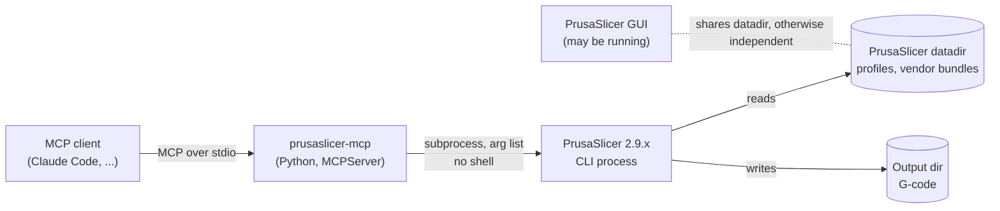

# Architecture

How `prusaslicer-mcp` works **today**. Why it works this way is in [`../decisions/`](../decisions/README.md).
If this document disagrees with the code, fix the document in the same change.

## Purpose and scope

An MCP server (stdio transport) that lets an MCP client such as Claude discover installed
PrusaSlicer printers and profiles, sanity-check a model, and slice it headlessly with the user's real
profiles. It wraps the **PrusaSlicer 2.9.x command line** ([ADR 0002](../decisions/0002-wrap-the-prusaslicer-2-9-cli.md)).

Out of scope: controlling or reading the running GUI, PrusaSlicer 3.x features (Lua plugins), and
printer control (use Prusa Connect / PrusaLink tooling for that).

## System context



Each tool call that touches PrusaSlicer starts a short-lived, separate CLI process. The GUI, if
open, is neither used nor disturbed.

## Code layout

```
src/prusaslicer_mcp/
  __init__.py   exports main()
  server.py     MCPServer instance, tool definitions, input validation, result models
  cli.py        run(): async subprocess wrapper around the PrusaSlicer binary
  config.py     executable + datadir discovery, env-var configuration
  gcode.py      parse print statistics from text G-code
  project.py    read the profiles and key settings stored in a PrusaSlicer project 3MF
  slicer_output.py  turn PrusaSlicer's stdout into warnings
tests/               unit tests (no PrusaSlicer) plus a few integration tests; see Testing below
.github/
  workflows/ci.yml             lint, types, audit, unit (3.12, 3.14), integration (macOS), commitlint
  workflows/release-please.yml release pull request from Conventional Commits
  scripts/setup-prusaslicer-macos.sh   installs PrusaSlicer and a throwaway data directory for CI
```

| Module | Responsibility | Depends on |
|---|---|---|
| `config.py` | Resolve `Config(executable, datadir, output_dir, timeout)` from env and platform defaults. Raises `ConfigError` (`PrusaSlicerNotFound` is a subclass) for an unusable setting. | stdlib |
| `cli.py` | `run(config, args, timeout)` → `CliResult(returncode, stdout, stderr)`. Prepends `--datadir` when configured. Kills the process on timeout (`CliTimeout`). | `config` |
| `gcode.py` | `parse_gcode_stats(path)` → `GcodeStats`. Rejects binary G-code. `layer_gap_warning(path)` reads the `;Z:` layer markers and describes stretches where the print jumps up by more than three typical layers (and at least 0.6 mm), meaning nothing is printed there. | pydantic |
| `slicer_output.py` | `parse_warnings(stdout)` → one string per PrusaSlicer warning. A warning is a block: a line containing "warning" plus the plain lines after it (more gaps, object name, advice), up to the next `NN => ...` progress line or the final export message. | stdlib |
| `project.py` | `read_project(path)` → `ProjectInfo` (stored printer/print/material profile names and `KEY_SETTINGS`) or `None` when the file is not a `.3mf` that embeds `Metadata/Slic3r_PE.config`. | stdlib, pydantic |
| `server.py` | Tool surface. Validates input, builds CLI args, shapes pydantic results. Lazily loads `Config` on first use (`get_config()`). | all of the above, `trimesh` |

## Tools

| Tool | PrusaSlicer involvement | Notes |
|---|---|---|
| `list_printers(technology)` | `--query-printer-models --printer-technology {FFF,SLA}` | Flattens model → nozzle variant → printer profile. Read-only. |
| `list_profiles(printer_profile)` | `--query-print-filament-profiles --printer-profile ...` | Print profiles with compatible filament profiles. Read-only. |
| `inspect_model(model_path, bed_*, max_height)` | none | `trimesh` load; size, volume (only when watertight), part count, optional fit check, and `project` (see `project.py`) for a 3MF saved from PrusaSlicer. `fits_bed` compares size only (rotation not considered). For a `.3mf` with a bed given it also warns when the stored position is off the bed, since PrusaSlicer keeps a 3MF's coordinates (see Known quirks). Read-only. |
| `slice_model(model_path, printer_profile?, print_profile?, material_profile?, overrides, output_path, center)` | `--export-gcode --binary-gcode=0 [--printer-profile ... --print-profile ... --material-profile ...] [--center X,Y] ...` | Writes G-code; returns path + `GcodeStats` + `settings_from` (`profiles`/`project`) + warnings. The three profiles are all-or-none; none is allowed only for a PrusaSlicer project, which is then sliced with its own saved settings ([ADR 0007](../decisions/0007-slice-prusaslicer-projects-with-their-own-settings.md)). `center=true` looks up the bed size (`_bed_center`, via `--query-printer-models`, for the given printer profile or the project's own) and centres on its middle, assuming a corner origin. Not read-only. |

Profile names are exact-match; callers get them from `list_printers` / `list_profiles`.

## Data flow: `slice_model`

```mermaid
sequenceDiagram
    participant C as MCP client
    participant S as server.slice_model
    participant R as cli.run
    participant P as PrusaSlicer
    participant G as gcode.parse_gcode_stats
    C->>S: model, [printer/print/material profile], overrides
    S->>S: validate model path + suffix; profiles all-or-none (none only for a project); validate override keys/values
    S->>R: args (--export-gcode --binary-gcode=0 [--printer-profile ...] --output ...)
    R->>P: exec (arg list, --datadir, timeout)
    P-->>R: exit code, stdout, stderr; G-code file
    R-->>S: CliResult
    S->>S: fail if exit != 0 or output missing
    S->>G: parse output file
    G-->>S: GcodeStats (time, filament, cost, layers)
    S->>G: layer_gap_warning (empty stretches in the model's height)
    S-->>C: SliceResult(gcode_path, stats, settings_from, warnings)
```

## Configuration

Read in `config.py`; documented in `.env.example` and the README ([ADR 0006](../decisions/0006-configuration-via-environment-and-direnv.md)).

| Variable | Used for | Default |
|---|---|---|
| `PRUSASLICER_PATH` | Executable. If set but invalid, the server errors rather than falling back. | auto-detect |
| `PRUSASLICER_DATADIR` | Passed as `--datadir` | platform default if the directory exists |
| `PRUSASLICER_MCP_OUTPUT_DIR` | Default G-code location, created in full if missing (it is the user's own setting) | `./output` (relative to the server's cwd, resolved at startup) |
| `PRUSASLICER_MCP_TIMEOUT` | Per-call timeout (s) for slicing, a positive number; queries use 60 s | `600` |

Executable resolution order: `PRUSASLICER_PATH` → `PATH` (`prusa-slicer`, `PrusaSlicer`, `prusa-slicer-console`) → platform install globs (macOS `/Applications/**/PrusaSlicer.app`, Windows `Program Files`).

### Client registration

`.mcp.json` at the repo root registers the server for Claude Code at project scope (`uv run prusaslicer-mcp`, no `env`, no paths). The client starts it with the project root as cwd, so the default `./output` lands in the git-ignored `output/` directory. The server inherits `PRUSASLICER_*` variables only from the environment `claude` was launched in; `.env` is not read by the server itself.

## Error handling and safety

- Every expected failure (bad input, PrusaSlicer not found, timeout, slicer or query error) is raised as `ToolError`. In MCP SDK 2.x only `ToolError` text reaches the client; any other exception is a "crash" whose message is withheld (`Error executing tool <name>` only). `server._run` converts `CliTimeout`, `get_config` converts `ConfigError` (PrusaSlicer not found, or an invalid setting such as a non-positive `PRUSASLICER_MCP_TIMEOUT`). A slicer "outside of the print volume" failure adds a hint to retry with `center=true`, and a "profile ... wasn't found" failure (from slicing or a query) adds a hint to take exact names from `list_printers` / `list_profiles`.
- No shell is ever involved. Subprocesses use `create_subprocess_exec` with an argument list and `stdin` closed.
- Setting overrides: keys must match `^[a-z][a-z0-9_]*$`, values may not contain newlines, and each is emitted as one `--key=value` argument (underscores become hyphens). Keys the server controls itself (`_RESERVED_OVERRIDES`: `export_gcode`, `binary_gcode`, the three profile flags, `output`, `datadir`, `center`) and `save`, which would write into the user's PrusaSlicer data directory, are rejected, because an override is appended after the server's own flags and would otherwise win (`binary_gcode=1` produced binary G-code, breaking [ADR 0005](../decisions/0005-always-slice-to-text-gcode.md)). Everything is validated before any folder is created, so a refused request leaves nothing on disk. A caller-supplied `output_path` may create only its own last folder: if neither that folder nor its parent exists the call is refused (a mistyped path would otherwise silently build a tree), and a folder that cannot be created is a readable `ToolError`.
- Model paths are resolved, must exist, and must have a supported extension (`.stl .3mf .obj .amf .step .stp`).
- Nothing writes into the PrusaSlicer data directory.
- stdout is reserved for the MCP protocol; diagnostics go to stderr.

## Known quirks (PrusaSlicer 2.9.7)

- **A successful slice can still be unprintable.** A scan with holes slices without error and with plausible statistics, but whole stretches of its height print nothing (an 88 mm statue had four gaps totalling 33 mm). PrusaSlicer says so in a multi-line warning that it truncates (`(Some lines not shown)`) and that did not list every gap, so `slice_model` returns that whole block and also checks the G-code's layer heights itself (`layer_gap_warning`).
- **Profile flags override a project's embedded settings.** Passing `--printer-profile`/`--print-profile`/`--material-profile` with a project 3MF makes PrusaSlicer use the plain profile values and ignore what the project saved (supports, brim, infill...). Without the flags it uses the project's own configuration. `slice_model` therefore omits them for a project when none are given ([ADR 0007](../decisions/0007-slice-prusaslicer-projects-with-their-own-settings.md)).
- `--query-*` actions **exit with status 1 even when they succeed**. `_query_json` therefore checks that the `-o` file exists, is non-empty, and parses, instead of the exit code.
- Printer *model* names in the vendor bundles are wx-escaped (`&&` renders as `&` in the GUI), while profile names use a single `&` (e.g. `Original Prusa MINI & MINI+ Input Shaper`). `list_printers` unescapes the model `name` for display (`_display_name` in `server.py`); `id` and every `printer_profile` value are passed through untouched. Always pass the `printer_profile` value, not the model name.
- Recent profiles default to **binary G-code**; we force text output ([ADR 0005](../decisions/0005-always-slice-to-text-gcode.md)).
- A plain 3MF (CAD export, not a PrusaSlicer project) keeps its stored coordinates, so a part modelled around the origin is half off the bed and slicing fails with "All objects are outside of the print volume"; `--merge` does not help for a single file. `slice_model(center=true)` passes `--center` with the bed middle. In our runs an STL was placed automatically without any flag (observed, not checked in the PrusaSlicer source). No other transform flags are exposed yet.

## Testing

`uv run poe check` runs lint, format check, type check and the unit tests; `uv run poe test-integration` runs the
rest. Tasks are defined once in `[tool.poe.tasks]` and CI calls the same ones ([ADR 0009](../decisions/0009-quality-gate-toolchain.md)).

| Kind | What it needs | Where |
|---|---|---|
| Unit | nothing; PrusaSlicer's command line is faked (`cli.run`), or a throwaway shell script stands in for it | most of `tests/` |
| Protocol | nothing; starts the real server as a subprocess and talks to it over stdio | `tests/test_stdio.py` |
| Integration | a real PrusaSlicer; marked `integration` automatically when a test uses the `prusaslicer` fixture, and skipped when no install is found | `tests/test_server.py` |

CI (`.github/workflows/ci.yml`) runs these jobs: lint and format, type check, dependency audit, unit tests on
Python 3.12 and 3.14 with a 95% coverage floor, integration tests on macOS, and commitlint, then a final `ci` job that depends on all of them and fails unless each one succeeded. Branch protection requires that one `ci` check (GitHub names checks after jobs, not workflows), so adding or renaming a job never breaks the ruleset; a new job must be added to the `ci` job's `needs`. The integration job
installs the official 2.9.7 `.dmg` (cached by version, `PRUSASLICER_VERSION` in the workflow) and builds a
throwaway data directory from the profiles inside the app. Linux is not covered because Prusa no longer attaches Linux
builds to its GitHub releases.

## Releases

Release Please (`.github/workflows/release-please.yml`, [ADR 0008](../decisions/0008-conventional-commits-and-release-please.md)) reads the Conventional Commits on `main` and keeps a release pull request open. Merging it tags `prusaslicer-mcp-vX.Y.Z`, publishes a GitHub release, writes `CHANGELOG.md`, and bumps the version in `pyproject.toml`, `uv.lock` and `.release-please-manifest.json`. Nothing is published to PyPI.

Only `feat`, `fix`, `perf` and `revert` commits appear in the notes and can trigger a release; every other type is hidden, and Release Please skips a release whose notes would be empty. Before 1.0 a `feat` bumps the minor version and a `fix` the patch.

## Extension points and next steps

Planned work is tracked in [`ROADMAP.md`](../../ROADMAP.md). Natural seams in the current design:

- New tools: add to `server.py` (or a new module if it grows), keeping validation and result models together.
- New CLI behaviour: extend arguments built in `server.py`; keep subprocess handling in `cli.py`.
- New statistics: extend `gcode.py` and its unit tests.
- Reading or writing other formats (3MF projects, bgcode) belongs in new modules, not `server.py`.
